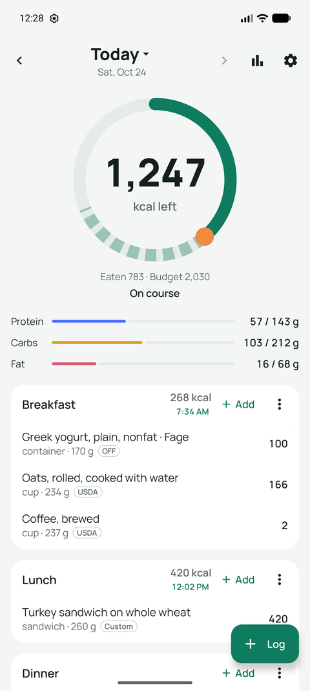
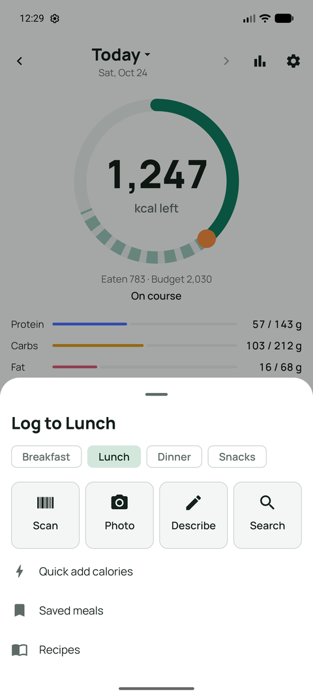
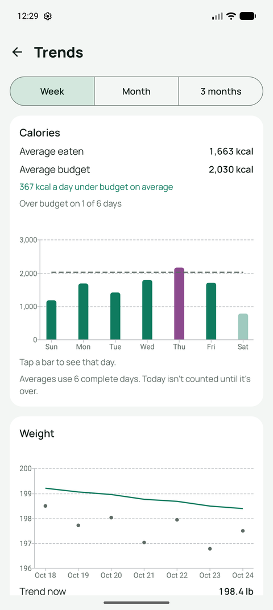

# Forkcast

A private, offline-first Android calorie and nutrition tracker. Log a meal by scanning a barcode, searching, taking a photo or describing it in a sentence. Forkcast tracks it against a daily budget built from your weight goal and your real maintenance calories.

  
  
  

## What it does

- **Barcode, search and labels:** USDA FoodData Central and Open Food Facts, plus nutrition-label scanning for products the databases don't know
- **AI logging:** a photo (up to three) or a short description goes to the AI provider you choose (Gemini, Claude or any OpenAI-compatible endpoint), comes back as itemized foods matched to USDA, and you review and adjust it. If one service is busy or out of its daily limit, the next one in your list takes over. Forkcast asks before it sends anything to a service for the first time
- **Budget with exercise eat-back:** the daily budget follows your goal and pace, learns your real maintenance from your weight trend, and adds part of unusually active days back
- **Health Connect:** weight, body fat, steps and workouts come in; food and water go out
- **Water:** one tap adds your usual glass, can, bottle or tumbler; drinks like water and plain tea count automatically
- **Trends:** calories against the budget, weight trend and goal date, macros, nutrients, meal timing, and a weekly check-in
- **Backups:** one backup file you save anywhere (optionally with a password), plus automatic weekly backups to a folder you choose
- **Privacy, bring your own key:** your data stays on your phone. No account, no server, no analytics. API keys are encrypted on the phone, and Android's unlock prompt is required before one is shown

## Basic use

1. Install the APK from [Releases](../../releases). Later versions arrive through Settings › Updates.
2. Read and accept the terms, then answer the onboarding questions (units, body, activity, goal) to get your daily budget.
3. Optional: add an AI service in Settings › AI services (a free Gemini key works; the guide walks you through it), connect Health Connect, and choose a folder for automatic backups in Settings › Backup & data.
4. Tap **Log** on Today and pick Scan, Photo, Describe or Search. The ring shows what's left for the day.

Android 10 or newer. English and Portuguese (Brazil).

For adults (18+). Not medical advice: Forkcast gives estimates, and those from photos can be well off, so weigh food when accuracy matters. Read the [Terms of Use and Disclaimer](TERMS.md) and the [Privacy Policy](PRIVACY.md).
