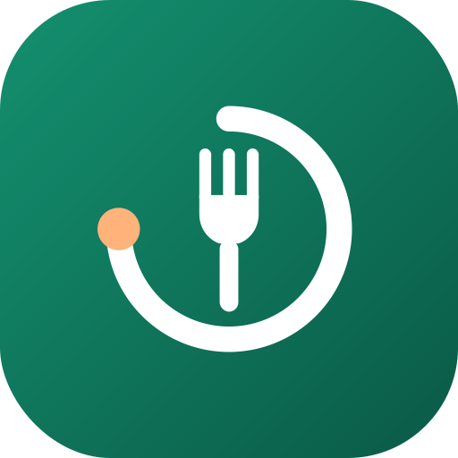

# Forkcast

A private, offline-first Android calorie and nutrition tracker. Log meals by barcode, search, or a photo with a short description; an AI model of your choice (Claude, Gemini, or any OpenAI-compatible endpoint) estimates the meal, and Forkcast tracks it against a budget built from your weight goal and your real maintenance calories.

- Your data stays on your phone, with JSON export/import and a nightly backup to your own Google Drive
- Bring your own API keys; an ordered list of AI profiles falls back to the next one when a provider is busy or out of quota
- Health Connect: weight, body fat, steps and workouts in; food and water out
- Learns your real maintenance calories from your weight trend, and adds part of unusual activity to the day's budget
- Trends, weekly check-in, recipes, saved meals, and nutrition-label scanning for products the databases don't know
- Home-screen widgets (calories left, one-tap water), app shortcuts and Quick Settings tiles

Docs: [Spec](docs/SPEC.md) · [AI providers](docs/AI_PROVIDERS.md) · [Design](docs/DESIGN.md) · [Setup](SETUP.md)

Not medical advice. Estimates, especially from photos, have real error; weigh food when accuracy matters.
