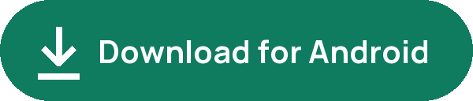
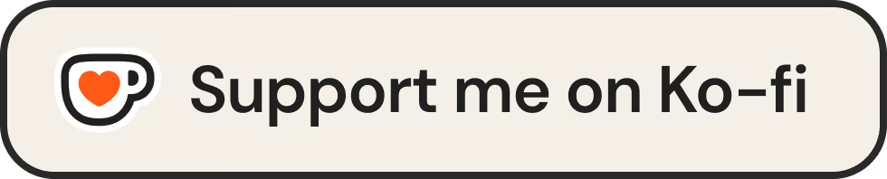
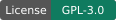
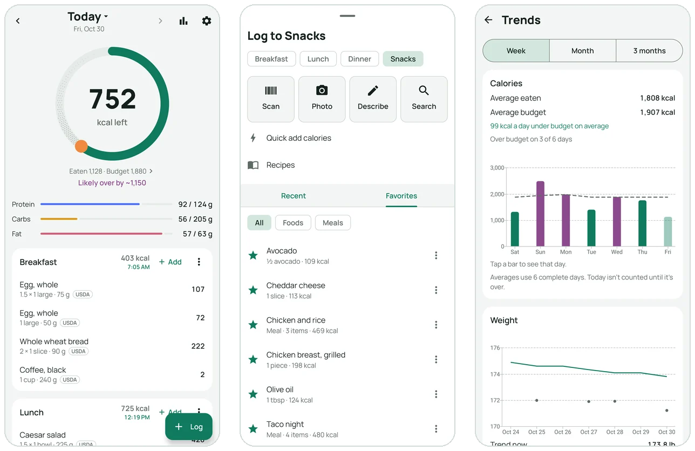
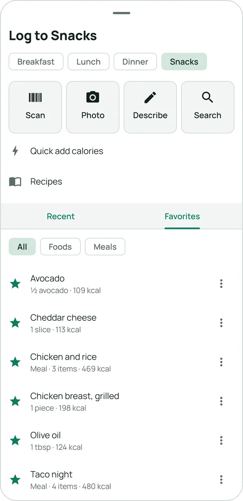
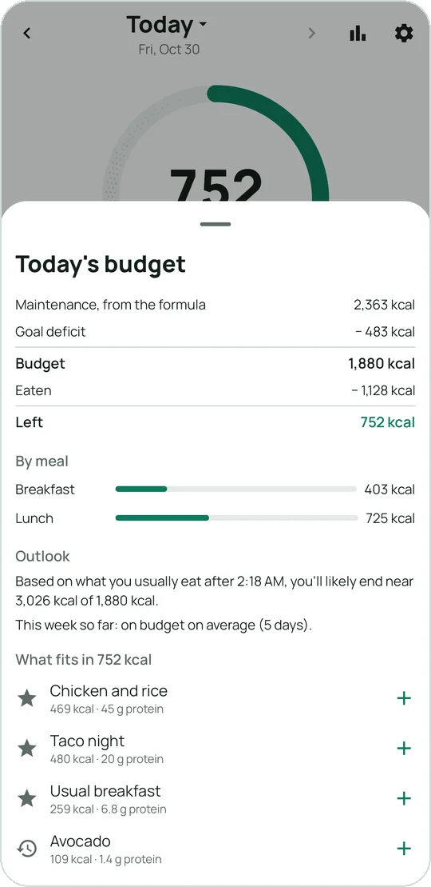
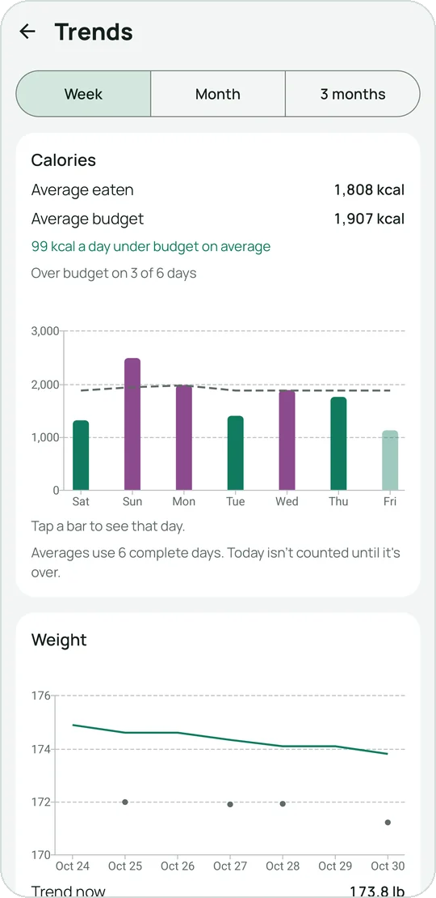
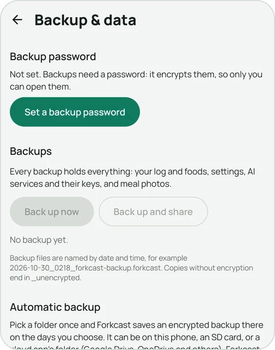
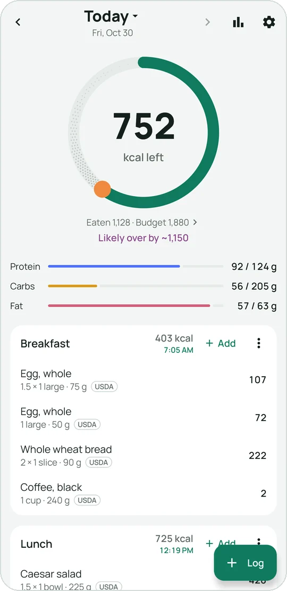
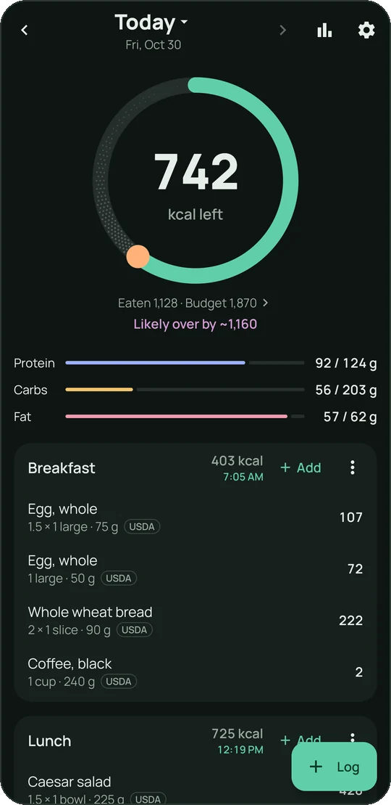

<h1 align="center">Forkcast</h1>

<b>A free calorie and nutrition tracker for Android. Your food log stays on your phone.</b>

  

  

  
  
  

  

## Why Forkcast

- **Log a meal your way:** scan a barcode, search, or describe it in a sentence or a photo.
- **A budget that learns:** your daily budget adjusts to the calories you actually burn, worked out from your weight trend.
- **Your data stays on your phone:** no account, no ads, no tracking.
- **Free and open source.**

## What it does

### Logging

Scan a barcode, search Open Food Facts (and USDA FoodData Central, with a free key), or read a nutrition label with the camera. Favorites and recent foods are one tap away.

With an AI service you set up, take a photo of a meal or describe it in a sentence: Forkcast shows an estimate with a likely range, which you can review and adjust. AI is optional, uses your own key, and its estimates can be wrong.

 

### A daily budget

Your budget starts from your goal and the pace you pick. After a few weeks of logging and weighing in, Forkcast compares what you ate with how your weight trend moved and adjusts to what your body actually burns. Unusually active days add part of the exercise back. Tap the ring to see how today's budget was worked out.

 

### Trends

Calories against your budget, your weight trend and goal date, macros, nutrients, meal timing, and a weekly check-in.

### Water and Health Connect

One tap adds your usual glass or bottle. With Health Connect, weight, body fat, steps and workouts come in from your other apps and devices, and your food and water go out.

 

### Backups

One encrypted backup file you save wherever you want, and automatic backups to a folder you choose, such as one your cloud drive syncs. Moving to a new phone is a restore away.

English and Portuguese (Brazil).

 

## Light and dark

  
  &nbsp;
  

Forkcast follows your phone's light or dark theme, or you pick one in Settings › Appearance. It can also take its colors from your wallpaper.

## Privacy at a glance

  

Forkcast has no servers and no accounts, and its developer receives none of your data. The [Privacy Policy](PRIVACY.md) lists exactly what goes where.

## Get started

1. **Download** the APK from the [latest release](https://github.com/djemes/forkcast/releases/latest).
2. **Install** it: your phone asks once to allow installs from your browser.
3. **Set up:** a few questions give you your daily budget. Then tap **Log**.

The [install guide](INSTALL.md) walks through every step, including updates and backups.

<b>Questions</b>

**Why isn't it on Google Play?**
Forkcast is a free project by one person and is published here on GitHub. You install it once; after that it updates itself from Settings › Updates.

**Do I need AI?**
No. Barcode, search, labels, recipes and quick add all work without it. AI is an extra for logging from a photo or a sentence, with a key from a provider you choose (Google's Gemini has a free tier).

**What leaves my phone?**
Only what a feature you use needs: a search or barcode goes to the food databases, a meal photo or description to your AI service, an update check to GitHub. Your weight, goals and other health data never go to an AI service. See the [Privacy Policy](PRIVACY.md).

**How do updates work?**
Settings › Updates checks this page's releases, downloads the new version, checks it, and asks Android to install it. Your data stays.

## Support Forkcast

Forkcast is free, with no ads. If it helps you, you can leave a tip at [ko-fi.com/gabemomp](https://ko-fi.com/gabemomp). Tips are voluntary and don't unlock anything. In the app, the link is in Settings › About.

---

AI is optional, uses your own key, and its estimates can be wrong. Forkcast is for adults (18+) and is not medical advice; see the [Terms of Use and Disclaimer](TERMS.md).

Help is best effort, through [GitHub](SUPPORT.md).

Free and open-source under the [GNU GPL, version 3](LICENSE), with an [additional permission](LICENSE-ADDITIONAL-PERMISSION.md). Food data from [Open Food Facts](https://openfoodfacts.org) (Open Database License) and [USDA FoodData Central](https://fdc.nal.usda.gov).

Forkcast is not affiliated with or endorsed by Google, Anthropic, OpenAI, the USDA, Open Food Facts, Samsung, or Ko-fi. Product names belong to their owners.
